<picture>
  <source media="(prefers-color-scheme: light)" srcset="assets/banner-light.svg">
  
</picture>

Full-stack developer with a backend focus. I build web apps with **Laravel**, **React (Inertia.js)**, and **PostgreSQL**, and I look after the server side when something breaks: security incidents, hosting, and maintenance.

<a href="https://yushika.my.id"><picture><source media="(prefers-color-scheme: light)" srcset="assets/btn-portfolio-light.svg"></picture></a>
<a href="https://yushika.my.id/cv"><picture><source media="(prefers-color-scheme: light)" srcset="assets/btn-cv-light.svg">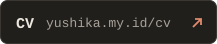</picture></a>
<a href="https://www.linkedin.com/in/yusuf-novandra-74705731a"><picture><source media="(prefers-color-scheme: light)" srcset="assets/btn-linkedin-light.svg">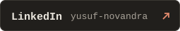</picture></a>
<a href="mailto:kirainova11@gmail.com"><picture><source media="(prefers-color-scheme: light)" srcset="assets/btn-email-light.svg">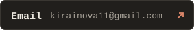</picture></a>

### What I work with

<picture>
  <source media="(prefers-color-scheme: light)" srcset="assets/stack-light.svg">
  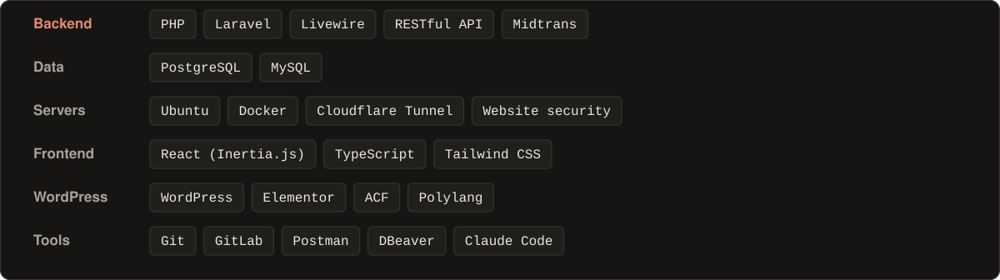
</picture>

### Selected work

  <a href="https://github.com/Irana06/shicomp">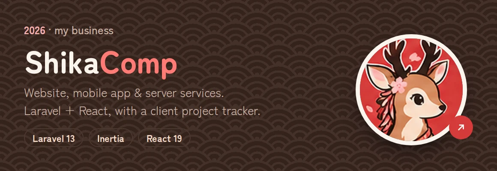</a>

<table>
  <tr>
    <td width="50%">
      <a href="https://github.com/Irana06/monshika">
        <picture>
          <source media="(prefers-color-scheme: light)" srcset="assets/card-monshika-light.svg">
          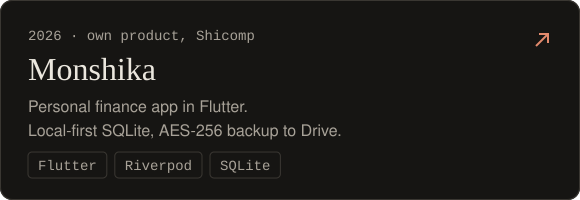
        </picture>
      </a>
    </td>
    <td width="50%">
      <a href="https://yushika.my.id/#projects">
        <picture>
          <source media="(prefers-color-scheme: light)" srcset="assets/card-lms-light.svg">
          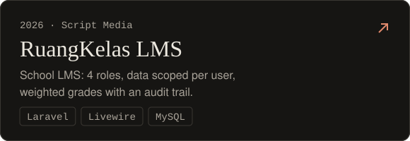
        </picture>
      </a>
    </td>
  </tr>
  <tr>
    <td width="50%">
      <a href="https://yushika.my.id/#projects">
        <picture>
          <source media="(prefers-color-scheme: light)" srcset="assets/card-toko-light.svg">
          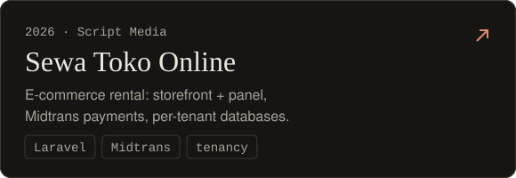
        </picture>
      </a>
    </td>
    <td width="50%">
      <a href="https://github.com/Irana06/portofolio-v2">
        <picture>
          <source media="(prefers-color-scheme: light)" srcset="assets/card-portfolio-light.svg">
          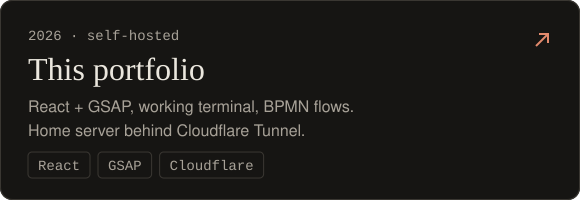
        </picture>
      </a>
    </td>
  </tr>
</table>

<a href="https://github.com/Irana06/monshika/releases/latest"><picture><source media="(prefers-color-scheme: light)" srcset="assets/btn-apk-light.svg"></picture></a>

### Currently learning

<picture>
  <source media="(prefers-color-scheme: light)" srcset="assets/learning-light.svg">
  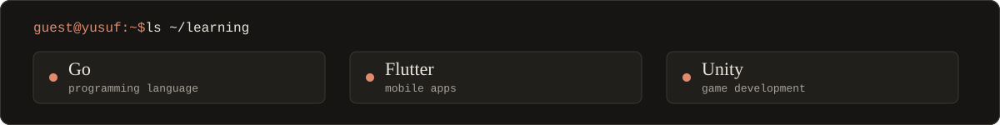
</picture>
